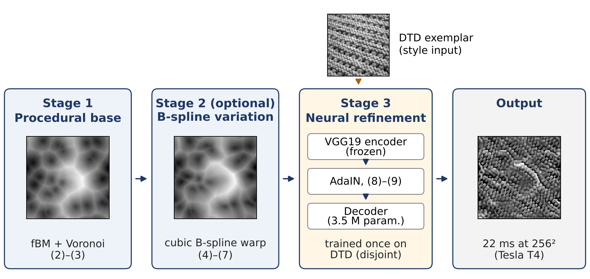

# Hybrid real-time texture synthesis: procedural fBM + B-spline structural variation + feed-forward neural refinement

Code and data for the revised manuscript

> *A Hybrid Framework for Real-Time Texture Synthesis with B-Spline Structural Variation and Feed-Forward Neural Refinement: A Large-Scale Experimental Study* (IJIGSP, manuscript PAPER023041, revision).

Release **v2.0-revision** contains exactly the code that produced every number of the revised manuscript.

## Pipeline

1. **Stage 1 – procedural base:** periodic fBM (6 octaves) blended with toroidal Voronoi noise (α = 0.5), computed on the GPU; the result is tileable.
2. **Stage 2 – B-spline structural variation (optional):** periodic tensor-product cubic B-spline displacement field (8×8 control grid, σ = 0.05), bilinear wrap-around warp. In this 2D study the field is random; it does **not** encode 3D surface curvature.
3. **Stage 3 – feed-forward refinement (proposed):** AdaIN network (frozen VGG19 encoder up to relu4_1 + 3.5 M-parameter decoder), trained **once** on 2,500 DTD images disjoint from the test and validation sets. Inference = one forward pass.
   Two operating modes: **fidelity mode** = Stages 1+3 (main method in all comparisons), **variation mode** = Stages 1+2+3 (more diverse outputs).
   *Hybrid-Opt* (comparison variant): lightweight U-Net fine-tuned for 150 Adam steps per texture.

## Main results (Tesla T4, DTD, grayscale)

256×256, 75 test textures × 3 seeds (mean over per-texture means):

| Method | LPIPS ↓ | FID ↓ | Diversity (LPIPS) ↑ | Time per texture | Peak GPU memory |
|---|---|---|---|---|---|
| Procedural | 0.907 | 390.8 | 0.357 | 5.3 ms | 38 MB |
| Image quilting (CPU) | **0.299** | **98.5** | 0.273 | 386 ms | – |
| VGG19 Gram-matrix optimization | 0.444 | 239.9 | 0.285 | 4832 ms | 171 MB |
| Stable Diffusion v1.5 (text) | 0.675 | 251.5 | – | 5174 ms | 611 MB |
| Stable Diffusion v1.5 + IP-Adapter (exemplar) | 0.565 | 185.8 | 0.467 | 4358 ms | 611 MB |
| Hybrid-Opt | 0.451 | 279.5 | 0.441 | 5733 ms | 379 MB |
| White noise + FF (ablation) | 0.476 | 247.5 | 0.322 | 18.5 ms | 50 MB |
| **Proposed, fidelity mode** | 0.432 | 270.9 | 0.347 | **20.9 ms** | **50 MB** |
| **Proposed, variation mode** | 0.442 | 277.1 | 0.363 | 21.7 ms | 50 MB |

Fidelity mode vs. Gram-matrix optimization (LPIPS): Holm-adjusted Wilcoxon p = 0.74 (no significant difference); vs. SD + IP-Adapter p = 6.7×10⁻¹² (proposed better). Procedural input vs. white noise: LPIPS 0.432 vs 0.476 (p = 5.3×10⁻⁷), diversity +7.7%. B-spline stage: diversity +4.9% (p = 1.2×10⁻¹¹) at +0.010 LPIPS. At 512×512 the fidelity mode takes 81.6 ms but is worse than Gram-matrix optimization in LPIPS (0.514 vs 0.472). SSIM/PSNR are low for all methods because synthesized textures are not pixel-aligned with their exemplars. Full tables: `results/RESULTS_PAPER023041_v4.xlsx` (new runs) and `results/RESULTS_PAPER023041_v3.xlsx`.

## Repository contents

| Path | Content |
|---|---|
| `notebooks/experiments_v4_colab.ipynb` | Third run: validation selection without the warp (w ∈ {1,3,10,30}), white-noise ablation decoder, SD + IP-Adapter baseline (scale selected on validation), 512×512 runs of the fidelity mode, LPIPS diversity, Wilcoxon/Holm tests; writes `RESULTS_PAPER023041_v4.xlsx`. |
| `notebooks/experiments_v3_1_colab.ipynb` | Main experiment notebook (Google Colab, T4): training of Hybrid-FF, validation-set hyperparameter selection, all methods except Stable Diffusion, FID/KID, statistics, figure. |
| `notebooks/experiments_v3_2_kaggle_resume.ipynb` | Same code adapted to Kaggle, resumes from saved checkpoints. |
| `notebooks/experiments_v2_stable_diffusion_baseline.ipynb` | First run of the corrected protocol; used **only** for the Stable Diffusion baseline (its code and seeds are identical; its rows are reused by v3, see `version` column in `raw_results.csv`). |
| `code/*.py` | The same notebooks as plain Python files (cells separated by `# %%`). |
| `results/raw_results.csv` | All 2,565 runs: texture, category, resolution, seed, method, SSIM, PSNR, LPIPS, time, memory, image file. |
| `results/RESULTS_PAPER023041_v3.xlsx` | Summary, Wilcoxon tests (W, raw and Holm p), FID/KID, sensitivity, per-texture means, configuration. |
| `results/sensitivity_v3.csv`, `results/sensitivity_v4.csv` | Validation-set sensitivity runs. |
| `results/raw_results_v4.csv`, `results/RESULTS_PAPER023041_v4.xlsx` | Runs and tables of the third run (IP-Adapter, white noise, fidelity mode at 512, diversity). |
| `code/diversity_inception_ssim.py`, `results/diversity_inception_ssim*.csv` | Secondary diversity measures (Inception-feature distance, 1 − SSIM between seeds). |
| `data_splits/` | Test (75), 512×512 subset (30), validation (15) and training (2,500) DTD file lists; the code asserts they are disjoint. |
| Release assets | Generated images (all methods, seeds, resolutions) and trained decoder checkpoints. |

## Reproducing the results

1. Open `notebooks/experiments_v3_1_colab.ipynb` in Google Colab, select **Runtime → Change runtime type → T4 GPU**.
2. Put `results/raw_results.csv` (provides the Stable Diffusion rows) into `MyDrive/PAPER023041_results/` on Google Drive.
3. **Runtime → Run all.** DTD is downloaded automatically from the official site. Total time ≈ 4–5 h (≈ 1.7 h one-time training of three decoders). The run resumes automatically after a disconnection.
4. Run `notebooks/experiments_v4_colab.ipynb` (needs the v3 outputs in the same Drive folder) for the IP-Adapter baseline, the white-noise ablation and the diversity analysis.
5. To regenerate the text-conditioned Stable Diffusion baseline, run `notebooks/experiments_v2_stable_diffusion_baseline.ipynb`.

Seeds: 0, 1, 2; per-run seed = seed·10⁷ + md5(texture id); Python/NumPy/PyTorch/CUDA seeded, cuDNN deterministic. Timing is end-to-end per texture (including all optimization steps), after GPU warm-up, with `torch.cuda.synchronize()`; model loading excluded.

Software used for the reported run: Python 3.13, PyTorch 2.14.1, torchvision 0.29.1, SciPy 1.16.3, scikit-image 0.25.2 (see `requirements.txt`).

## Changes with respect to the original submission

See `CHANGES.md`. All numbers of the original submission are superseded.

## Data

Describable Textures Dataset (DTD): M. Cimpoi et al., CVPR 2014, https://www.robots.ox.ac.uk/~vgg/data/dtd/
